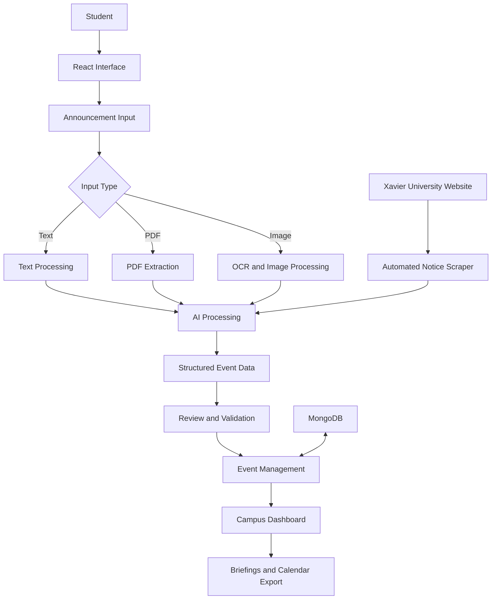
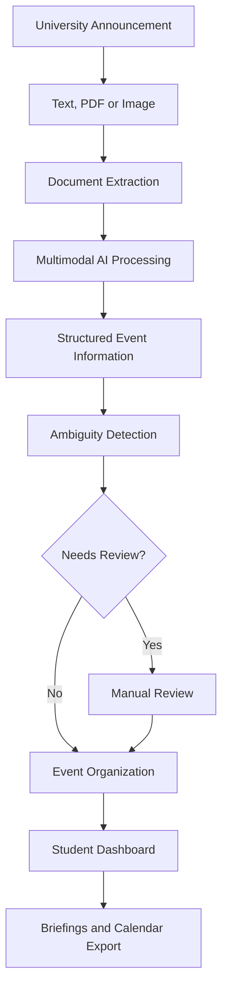

# 🌌 AI Gravity Organiser

<p align="center">
  <strong>An AI-Powered University Announcement Intelligence & Campus Productivity Platform</strong>
</p>

<p align="center">
  <a href="https://www.aigravity.bond/">
    
  </a>
  
  
  
  
</p>

---

## 📌 Overview

**AI Gravity Organiser** is an AI-powered university announcement intelligence and campus productivity platform designed to simplify how students discover, understand, organize, and manage academic announcements and university events.

University notices are often distributed through PDFs, images, website announcements, and lengthy text documents. Extracting important information manually can be time-consuming and makes it easy to overlook deadlines, venues, and event requirements.

AI Gravity Organiser addresses this problem by combining multimodal AI processing, OCR, automated event extraction, campus notice synchronization, and personalized event management into a unified platform.

The application is designed around the student experience, helping transform unstructured university announcements into structured and actionable information.

**🌐 Live Application:** https://www.aigravity.bond/

---

## 🎯 Problem Statement

Students frequently encounter challenges when managing university announcements:

- Important information is scattered across different sources.
- Notices are published in PDF, image, and text formats.
- Important deadlines and event details can be difficult to identify.
- Manually tracking academic events requires time and effort.
- Students may overlook important announcements.
- Keeping track of upcoming workshops, examinations, and competitions can be challenging.

AI Gravity Organiser aims to make this information easier to access, understand, and manage.

---

## 💡 Our Solution

The platform introduces an AI-powered workflow that processes university announcements and converts them into structured event information.

Its major capabilities include:

1. **Multimodal Announcement Processing:** Analyzes announcement text, PDFs, and images.
2. **Intelligent Information Extraction:** Identifies event titles, dates, deadlines, venues, audiences, and prerequisites.
3. **Campus Notice Synchronization:** Scans the Xavier University Patna website for new announcements.
4. **Smart Event Organization:** Organizes announcements into an accessible event management interface.
5. **Automated Briefings:** Supports morning and evening campus information briefings.
6. **AI Campus Assistant:** Provides a conversational interface for interacting with campus event information.

---

## ✨ Key Features

### 1. 🤖 AI-Powered Announcement Intelligence

- Processes announcement text, PDF documents, and images.
- Uses multimodal AI for information extraction.
- Extracts structured event information.
- Identifies important dates and deadlines.
- Identifies event venues and target audiences.
- Extracts prerequisites and event highlights.
- Includes ambiguity detection and manual review workflows.

### 2. 📄 OCR and Document Processing

- Browser-based OCR using Tesseract.js.
- PDF text extraction using PDF processing libraries.
- Image-based announcement processing.
- AI-assisted interpretation of unstructured documents.
- Structured notice parsing.

### 3. 🏛️ University Website Synchronization

The application includes an automated notice synchronization pipeline for Xavier University Patna.

**Source:** https://xup.ac.in/

Capabilities include:

- Fetching university homepage announcements.
- Scanning the university noticeboard.
- Identifying new notice candidates.
- AI-assisted announcement extraction.
- Deterministic regex-based fallback extraction.
- Avoiding duplicate event ingestion.
- Manual synchronization trigger.
- Synchronization status and telemetry.

The server code configures scheduled synchronization for university notices.

### 4. 📅 Smart Event Management

- Centralized campus event organization.
- Event categorization.
- Date-based event filtering.
- Urgency and relevance indicators.
- Today's event highlights.
- Tomorrow's event highlights.
- Event details and prerequisites.
- Task checklists associated with events.

### 5. 🌅 Automated Campus Briefings

The platform includes morning and evening briefing workflows.

Features include:

- Morning briefing preparation.
- Evening preparation briefing.
- Consolidated event briefings.
- Email dispatch functionality.
- Dispatch receipt interface.
- Scheduled server-side briefing jobs.

The server configures daily scheduled jobs for morning and evening automated dispatch.

Actual email delivery depends on the configured email service and credentials.

### 6. 💬 AI Campus Assistant

- Conversational AI interface.
- Contextual interaction with campus information.
- Model selection interface.
- Role-based presets.
- AI-assisted access to event-related information.

### 7. 🌌 Interactive User Interface

The platform features a distinctive space-inspired interface.

- Cosmic animated background.
- Constellation-style event visualization.
- Interactive orbital station scene.
- Animated interface elements.
- Event visualization through interactive components.
- Responsive application layout.

### 8. 📤 Calendar Integration

- Export event information in ICS calendar format.
- Support for adding events to compatible calendar applications.

### 9. 📊 System Monitoring

- Application health endpoint.
- System status information.
- Uptime monitoring integration.
- University synchronization telemetry.

---

## 🛠️ Technology Stack

| Technology | Purpose |
|---|---|
| React 19 | Frontend interface |
| TypeScript 5.8 | Type-safe development |
| Vite 6 | Frontend build tooling |
| Tailwind CSS 4 | Styling and responsive UI |
| Node.js | Backend runtime |
| Express.js | Backend API framework |
| MongoDB | Database integration |
| Google GenAI SDK | Gemini integration |
| 1min.AI API | Multimodal AI and document processing |
| Tesseract.js | Browser-based OCR |
| pdf-parse | PDF text extraction |
| PDF.js | PDF processing |
| Three.js | 3D visualization |
| React Three Fiber | React-based 3D rendering |
| Motion | Interface animations |
| Node-Cron | Scheduled automation |
| Nodemailer | Email functionality |
| Lucide React | Interface icons |

---

## 🏗️ System Architecture

AI Gravity Organiser follows a React-based frontend and Node.js/Express backend architecture.

### High-Level Architecture



### Backend API Capabilities

The source code implements API endpoints for:

| Endpoint | Purpose |
|---|---|
| `/api/health` | Application health information |
| `/api/auth/login` | Authentication |
| `/api/uptime` | Uptime monitoring |
| `/api/system-status` | System status |
| `/api/parse-announcement` | Announcement processing |
| `/api/events` | Event retrieval and management |
| `/api/sync-events` | Event synchronization |
| `/api/xup-sync-status` | University synchronization status |
| `/api/xup-sync-now` | Manual synchronization |
| `/api/automated-briefs-status` | Automated briefing status |
| `/api/dispatch-consolidated-brief` | Consolidated briefing dispatch |

---

## 🔄 Announcement Processing Workflow



---

## 🗂️ Project Structure

```text
ai-gravity-organiser/
│
├── public/
│
├── src/
│   ├── components/
│   │   ├── AuthGate.tsx
│   │   ├── Header.tsx
│   │   ├── EventCard.tsx
│   │   ├── FilterBar.tsx
│   │   ├── GeminiChatbot.tsx
│   │   ├── MultimodalInput.tsx
│   │   ├── NoticeReviewModal.tsx
│   │   ├── MorningBriefModal.tsx
│   │   ├── ConsolidatedBriefModal.tsx
│   │   ├── UptimePage.tsx
│   │   └── ConstellationStarMap.tsx
│   │
│   ├── data/
│   │   └── sampleAnnouncements.ts
│   │
│   ├── utils/
│   │   ├── audio.ts
│   │   ├── browserOcr.ts
│   │   ├── calendar.ts
│   │   └── noticeParser.ts
│   │
│   ├── App.tsx
│   ├── main.tsx
│   ├── index.css
│   └── types.ts
│
├── server.ts
├── index.html
├── package.json
├── vite.config.ts
├── tsconfig.json
└── .env.example
```

---

## 🚀 Getting Started

### Prerequisites

- Node.js
- npm or Bun
- MongoDB connection
- Required AI service API credentials

### 1. Clone the repository

```bash
git clone https://github.com/YOUR-USERNAME/ai-gravity-organiser.git
```

### 2. Navigate to the project

```bash
cd ai-gravity-organiser
```

### 3. Install dependencies

Using npm:

```bash
npm install
```

Or using Bun:

```bash
bun install
```

### 4. Configure environment variables

Create a `.env` file in the project root using `.env.example` as a reference.

Configure the required variables:

```env
ONEMIN_API_KEY=
GEMINI_API_KEY=

APP_URL=

MONGODB_URI=

SMTP_USER=
SMTP_PASS=
SMTP_HOST=
SMTP_PORT=
RECIPIENT_EMAIL=

APP_USERNAME=
APP_PASSWORD=
```

Use your own credentials and secure values. Do not commit `.env` files or expose API keys in public repositories.

### 5. Run the development server

```bash
npm run dev
```

Or:

```bash
bun run dev
```

### 6. Build for production

```bash
npm run build
```

### 7. Start the production server

```bash
npm start
```

---

## 🔐 Security Considerations

Before deploying or publishing the source code:

- Store API credentials in environment variables.
- Never expose private API keys in frontend code.
- Replace default authentication credentials.
- Rotate any credentials previously exposed in source code.
- Restrict access to administrative endpoints.
- Configure secure authentication and authorization.
- Validate and sanitize uploaded documents and user input.
- Review email and database access permissions.

---

## 🔮 Future Scope

Potential future enhancements include:

- Personalized announcement recommendations.
- Advanced student-specific notification preferences.
- More multilingual announcement processing.
- Improved event relevance ranking.
- Enhanced calendar synchronization.
- Additional university integrations.
- Expanded analytics for campus announcements.
- More advanced AI-assisted academic planning.

These are potential improvements rather than claims about currently implemented functionality.

---

## 🎯 Project Objectives

AI Gravity Organiser aims to:

- Reduce the effort required to understand university announcements.
- Make important campus information easier to access.
- Automate the extraction of useful information from documents.
- Help students manage upcoming academic activities.
- Improve awareness of workshops, examinations, and competitions.
- Explore practical applications of AI in university environments.

---

## 👨‍💻 Development & Contribution

**Developed by Aditya Raj Verma**

AI Gravity Organiser is an individual project developed with AI-assisted development workflows.

My contributions include:

- Designing the application's interface and user experience.
- Developing the application through AI-assisted coding workflows.
- Working with React and TypeScript components.
- Exploring backend development using Node.js and Express.
- Integrating AI-powered announcement processing workflows.
- Exploring document extraction, OCR, and event automation.
- Iterating on the application through testing and development.

This project represents my exploration of practical AI applications, full-stack development, and technology-driven problem-solving.

---

## 🌐 Live Demo

**[Visit AI Gravity Organiser](https://www.aigravity.bond/)**

**University Notice Source:** https://xup.ac.in/

---

## 👤 Developer

**Aditya Raj Verma**

BCA – Data Science Student  
Xavier University, Patna

- LinkedIn: https://www.linkedin.com/in/aditya-rajverma/
- GitHub: https://github.com/aditya-rajverma

---

<p align="center">
  <strong>AI Gravity Organiser</strong>
  <br />
  <i>Turning Campus Announcements into Actionable Intelligence.</i>
  <br /><br />
  Built with curiosity, creativity, and AI-assisted development.
</p>
